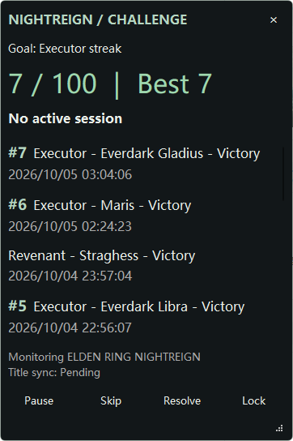
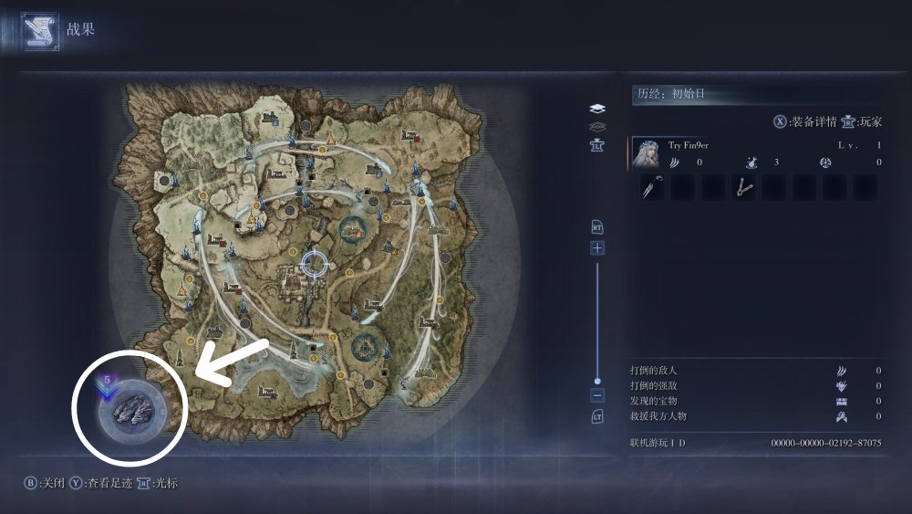

# Nightreign Challenge Tracker

Nightreign Challenge Tracker is a small Windows desktop HUD that watches the
Nightreign game window, records challenge runs, and keeps track of your streak.

It runs image recognition on captured game window and does not interact
with game memory or modify game files, so it is not expected to affect the
game's anti-cheat.

<p align=center></p>

## Install and start

1. Open the [latest GitHub release](https://github.com/guansss/NR-challenge-tracker/releases/latest).
2. Download the `Nightreign-Challenge-Tracker-...-windows.zip` file from the
   release's **Assets**.
3. Extract the ZIP into a folder you can write to, such as a folder in
   **Documents**.
4. Double-click **Nightreign Challenge Tracker.exe** to start the tracker.
5. Start Nightreign, or leave it running. Keep its game window visible and
   unminimized while you play.

The HUD stays above other windows. Drag it to move it and use the corner grip to
resize it. It shows the active Challenge, its analysis, recent runs, and
whether the game is being monitored.

## While you play

The tracker looks for the Nightreign game window and watches for preparation
and result screens. It records runs automatically when it recognizes them.

IMPORTANT: On the result screen (you'll hear a "ding" sound), scale the map
to its minimum size so the Nightlord icon is fully visible for recognition.
You can inspect the real-time recognition result in the HUD.



HUD controls:

- **Pause** temporarily stops watching the game; choose **Resume** to continue.
- If a run is missed or recorded incorrectly, select it in the recent-runs list
  and choose **Resolve**. Check the character, boss, variant, outcome, and times,
  then save the correction.
- **Skip** discards the selected run (or the current run if none is selected).
- Open **Settings**, then use the **Active Challenge** selector to switch
  Challenges or choose **Manage Challenges...** to create, edit, and delete
  them. A **Normal** Challenge counts all included sessions and wins. A
  **Winning Streak** Challenge has its own eligible Nightfarer and goal. Each
  Challenge can exclude sessions from its analysis without hiding them from
  run history.
- **Lock** lets mouse clicks pass through the HUD so you can click the game
  underneath it. Press **Ctrl+Shift+L** to unlock it.
- Close the HUD with **×** when you are finished. Your run history is saved
  automatically.

## Optional: sync your Bilibili live-room title

Title syncing is optional. The tracker can update your room title to include
your streak, but this requires the Tampermonkey browser extension and an
additional userscript.

1. Install Tampermonkey in your browser.
2. Download `bilibili.user.js` from the latest GitHub release and
   install it in Tampermonkey.
3. Start the tracker and sign in to the Bilibili account whose room title you
   want to change.
4. Open the [Bilibili live center](https://link.bilibili.com/p/center/index#/my-room/start-live)
   for that account. Keep the tracker running while you want syncing to happen,
   and keep the live-center tab in the foreground. If the tab is in the
   background, the browser may suspend its update task while the tab is asleep.

Check the HUD's **Title sync** status. Confirm that the correct account and room
are open, and check the title in Bilibili after syncing.

Want a different room title? Open **Settings** and change the title template.
The template supports `{wins}`, `{total}`, `{streak}`, and `{goal}`. A Normal
Challenge fills `wins` with its included victories and `total` with included
sessions; a Winning Streak Challenge fills `streak` and `goal`. Values that do
not apply to the active Challenge are `0`. For example:
`Nightreign (W:{wins}/{total} S:{streak}/{goal})`.

## Your files and settings

The tracker keeps its files in the folder where you extracted it:

- `history.yaml` stores your run history.
- `user-config.yaml` stores the settings you changed, including your Challenges.
- `state.json` stores the HUD's size and position.

These files are local to that folder. To update the app, back up your folder
first, then extract the new release into it. Keep your existing
`history.yaml`, `state.json`, and `user-config.yaml`.

By default, the interface language follows your Windows language (English or
Chinese), and the tracker starts with an **All Sessions** Normal Challenge.
Open **Settings** on the HUD to switch the active Challenge, manage Challenge
analyses, and edit the remaining application options.
Debug screenshots are disabled by default; enable them in **Settings** to save
screenshots in `debug/screenshots` beside the app executable.

## Troubleshooting

- **The HUD says the game window is unavailable:** Make sure Nightreign is
  running, visible, and not minimized.
- **The tracker does not recognize screens:** Keep the game visible and use a
  supported window-capture mode. You can pause and resume monitoring from the
  HUD.
- **A run has the wrong character, boss, or outcome:** Select the run in the
  recent-runs list and use **Resolve** to correct it.
- **Bilibili title syncing is not working:** Make sure the tracker is running,
  Tampermonkey is enabled, and the correct Bilibili account's live-center page
  is open.

## Game language support

Automatic recognition currently supports the Chinese version of Nightreign. To
use automatic recognition with another language, you will need to provide your
own result-screen screenshots in that language and regenerate the recognition
templates. This requires the project source and a Python environment; it is an
advanced setup and is not a setting in the portable app.

Put the screenshots in `assets/dataset/result-screens`. The dataset should
include:

- At least one result screenshot for every Nightlord and every Everdark version.
- At least one screenshot for each outcome: first day, second day, final day,
  and final-day victory.
- The map scaled to its minimum size, without moving the cursor.
- Screenshots from a regular map, not the Great Hollow map.
- `.jpg` filenames in the format
  `<nightlord>(-everdark)_<day1|day2|day3|victory>.jpg`. For example,
  `adel_day1.jpg` or `adel-everdark_victory.jpg`.

From the project root, regenerate the templates using the project's virtual
environment:

```powershell
.\.venv\Scripts\python.exe .\tools\extract_templates.py
```

## For developers

To run from source on Windows, install the project dependencies and start the
app from the repository root:

```powershell
.\.venv\Scripts\python.exe -m pip install -r requirements.txt
.\.venv\Scripts\python.exe -m app.main
```

To build a portable package:

```powershell
.\.venv\Scripts\python.exe -m pip install -r requirements-build.txt
.\.venv\Scripts\python.exe .\tools\build_release.py
```

The package is created in `dist` as
`Nightreign-Challenge-Tracker-v<version>-windows.zip`, alongside the
`bilibili-<version>.user.js` userscript asset. The version is set in
`pyproject.toml`. A GitHub Release is published automatically when a matching
`v<version>` tag is pushed.

Run the unit tests, type checker, and offline recognition evaluator with:

```powershell
.\.venv\Scripts\python.exe -m unittest discover -s tests -v
.\.venv\Scripts\python.exe -m pyrefly check
.\.venv\Scripts\python.exe .\tools\recognize_screenshots.py --dataset
```
